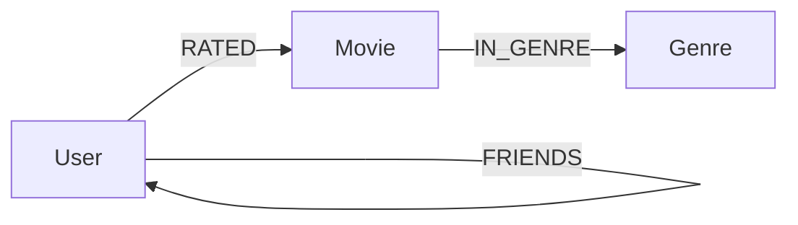

# Neo4j — MovieLens Data Analysis

Projet réalisé dans le cadre de la formation Data Analyst d’AJC Formation, module Big Data / NoSQL.

## Objectifs
- Importer six fichiers CSV dans une base orientée graphe.
- Analyser les utilisateurs, les films et les évaluations avec Cypher.
- Explorer les relations sociales, les amis communs et les degrés de séparation.

## Technologies
Neo4j Desktop 2.3.1 · Cypher 25 · CSV · GitHub

## Modèle de données

## Résultats observés
| Indicateur | Valeur |
|---|---:|
| Nœuds | 619 |
| Relations | 12 944 |
| Utilisateurs | 200 |
| Évaluations | 11 310 |
| Professions distinctes | 21 |

Le contrôle d’import révèle un écart d’un nœud par rapport aux 620 attendus, à investiguer.

## Documentation et livrables
- `scripts/` : requêtes Cypher commentées.
- [Rapport de réalisation (PDF)](reports/Rapport_TP_Neo4j_MovieLens.pdf)
- [Rapport de réalisation (Word)](reports/Rapport_TP_Neo4j_MovieLens.docx)
- [Sujet du TP Neo4j](documentation/Neo4j_TP.pdf)

## Reproduction
Créer une base Neo4j nommée `movielens`, importer les nœuds puis les relations à partir des six CSV autorisés, et exécuter les requêtes individuellement. Les relations utilisées sont `FRIENDS`, `IN_GENRE` et `RATED` (propriété `rating`).

## Source
Sous-ensemble pédagogique du jeu de données [MovieLens](https://movielens.org/). Les supports pédagogiques et données sources ne sont pas redistribués sans autorisation.
